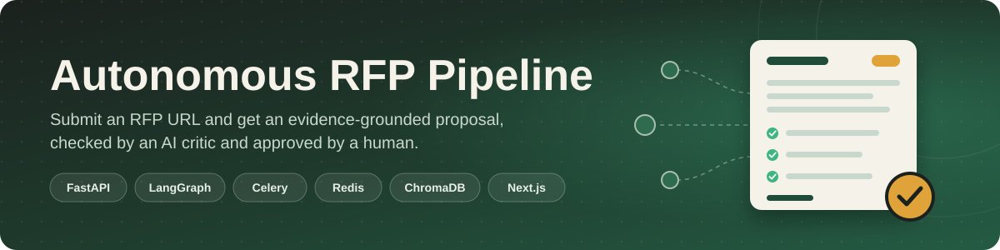
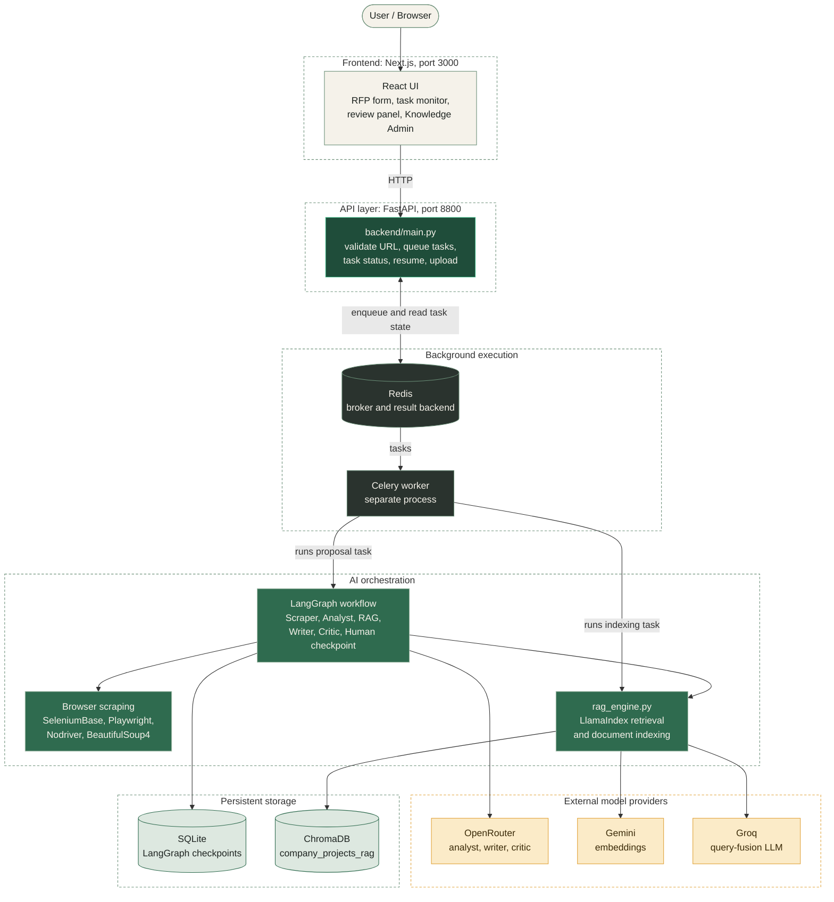
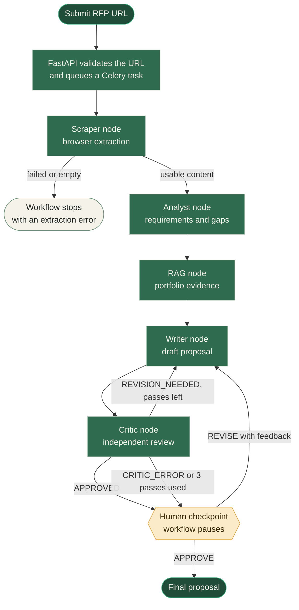
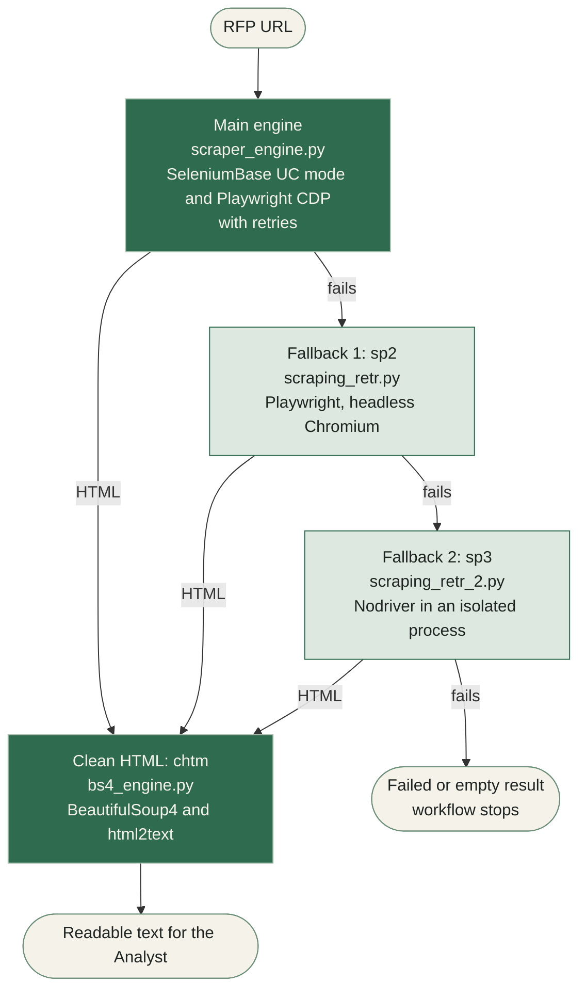
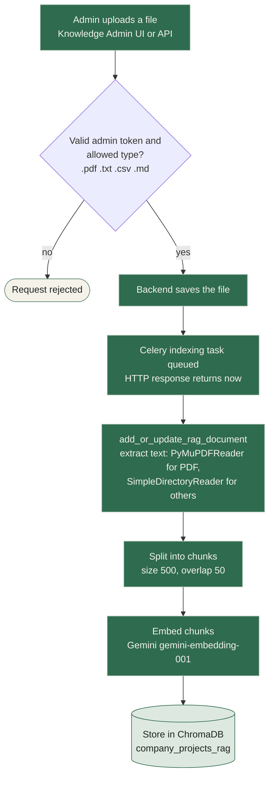
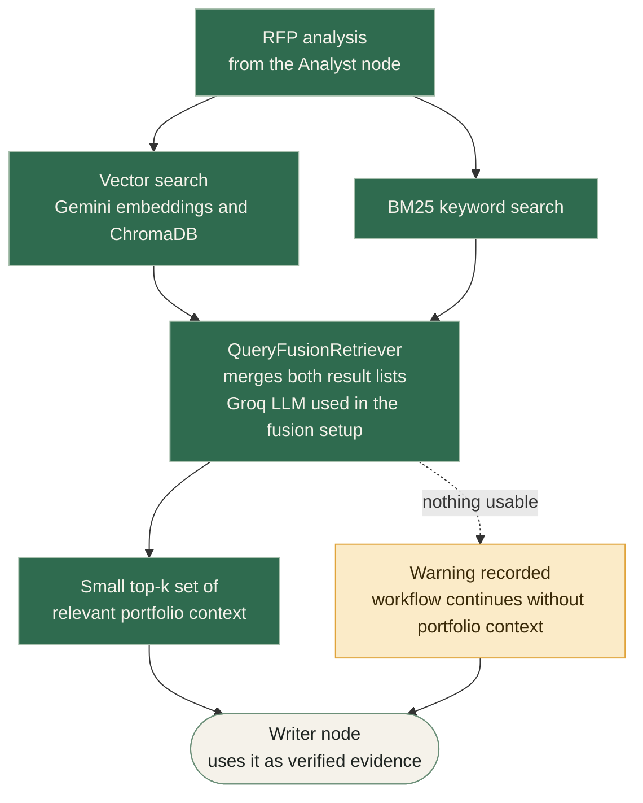

<div align="center">



<br>


**An agentic RFP intelligence system that extracts software project requirements from web pages, retrieves relevant portfolio knowledge, generates evidence-grounded proposals, and supports a human review workflow.**

[Quick start on Windows](#windows-setup) &nbsp;|&nbsp; [Architecture](#system-architecture) &nbsp;|&nbsp; [API reference](#api-reference) &nbsp;|&nbsp; [Limitations](#known-limitations) &nbsp;|&nbsp; [Troubleshooting](#troubleshooting)

</div>

---

## Overview

Writing a good proposal for a software RFP (request for proposal) takes time. You have to read a long page, find what the client really needs, remember which past work is relevant, and write something specific without exaggerating.

**Autonomous RFP Pipeline** automates the first draft and checks it before a person sees it.

```text
Submit an RFP URL  →  Extract its requirements  →  Retrieve relevant portfolio evidence
        →  Generate a proposal  →  Critically evaluate it  →  Send it for human review
```


> [!NOTE]
> The web interface is currently labelled **AegisIQ**. This repository and this document use the name **Autonomous RFP Pipeline**. Some older files still use other names (see [Project Notes](#project-notes)).

### What goes in and what comes out

| | Details |
|---|---|
| **Main input** | An HTTP or HTTPS URL of a software RFP, tender, or relevant job posting |
| **Main output** | A short client-facing proposal draft (about 100 to 180 words) that a human reviews |
| **Portfolio input** | PDF, TXT, CSV, or MD files uploaded through Knowledge Admin |

The main workflow takes a **web URL**. It does not take an uploaded RFP PDF. File uploads are only for the portfolio knowledge base.

---

## Key Capabilities

| Capability | What it means |
|---|---|
| Web content extraction | Opens the RFP page in a real browser and falls back to other methods if the first one fails |
| Requirement analysis | An AI analyst separates mandatory needs, preferences, deadlines, budgets, and open questions |
| Portfolio RAG | Finds matching past-project evidence so the proposal does not rely on invented experience |
| Proposal writing | Produces a short, specific proposal with strict rules against made-up facts |
| Independent critic | A second AI stage checks the draft for gaps, unsupported claims, and contradictions |
| Human review gate | The workflow pauses and waits for a person to approve or request changes |
| Resumable workflow | Workflow state is saved in a SQLite checkpoint so a paused run can continue |
| Web interface | Next.js app with task monitor, editable draft, Markdown preview, copy, download, and Knowledge Admin |

<details>
<summary><b>Plain-English glossary</b> (click to expand)</summary>

<br>

| Term | Meaning in this project |
|---|---|
| RFP | A document or web page where a client describes a project and asks for proposals |
| Agent | One AI stage with one job, such as analyzing or writing |
| LangGraph | A library that connects the agents into a workflow and saves its state |
| Checkpoint | A saved snapshot of the workflow, so it can pause and resume later |
| RAG | Retrieval-Augmented Generation. The system looks up relevant documents first, then writes using them |
| Embedding | A list of numbers that represents the meaning of a text, used for similarity search |
| ChromaDB | The vector database that stores portfolio embeddings |
| BM25 | A classic keyword-matching search method |
| Celery | A task queue that runs slow jobs in the background |
| Redis | A fast data store used here as the Celery message broker and result store |

</details>

---

## System Architecture

The project has a frontend, an API, a background worker, and an AI workflow. They are separate on purpose. The API answers quickly. The slow AI work runs in the Celery worker.



| Layer | Component | Job |
|---|---|---|
| Frontend | Next.js app in `frontend/` | Collects the URL, shows task state, lets a person review the draft |
| API | FastAPI in `backend/main.py` | Validates input and creates background tasks |
| Queue | Redis and Celery | Run long jobs outside the web request |
| AI workflow | LangGraph in `backend/main.py` | Runs the agents in order and pauses for human review |
| Providers | OpenRouter, Gemini, Groq | Language models and embeddings |
| Storage | SQLite and ChromaDB | Workflow checkpoints and portfolio vectors |

> [!IMPORTANT]
> Starting FastAPI does **not** start the Celery worker. Redis must also run on its own. See [Running the Application](#running-the-application).

---

## Complete Workflow

When a user submits an RFP URL, the request goes through these stages:



**What each step does**

1. **Submit.** FastAPI checks that the URL is valid HTTP or HTTPS and queues a Celery task.
2. **Scrape.** A browser opens the page and extracts its content. If the result is empty or unusable, the workflow stops here.
3. **Analyze.** An AI analyst turns the page into a structured list of requirements and open questions.
4. **Retrieve.** The system searches the portfolio knowledge base for matching past work.
5. **Write.** A writer agent drafts a short proposal using only the RFP, the analysis, and verified portfolio context.
6. **Critique.** A separate critic agent reviews the draft and returns a decision.
7. **Human review.** The workflow pauses. A person can approve, edit, or request another pass.

**Special cases**

| Situation | What happens |
|---|---|
| Scraping fails or returns empty content | Workflow stops before any AI analysis |
| No usable portfolio context | Workflow continues and records a warning |
| Critic returns `REVISION_NEEDED` | Draft goes back to the writer, up to 3 writer passes |
| Critic returns `APPROVED` | Draft still goes to a human. The critic does not skip review |
| Critic output cannot be parsed | Status is `CRITIC_ERROR`. The draft goes to manual review |
| Maximum writer passes reached | Draft goes to manual review |

---

## AI Agents

All agents are LangGraph nodes in `backend/main.py`.

| Node | Function | Role |
|---|---|---|
| Scraper | `scraper_node` | Calls the scraping engine and validates the result |
| Technical Analyst | `analyst_node` | Internal requirement analysis |
| Portfolio RAG | `rag_node` | Retrieves verified project knowledge |
| Proposal Writer | `writer_node` | Writes the client-facing proposal |
| Independent Critic | `critic_node` | Quality control on the draft |
| Human Checkpoint | `human_checkpoint_node` | Pauses with LangGraph `interrupt()` |

### Technical Analyst

This is an internal stage. It is not a client-facing proposal. It extracts:

- The business goal.
- Explicit technical requirements and deliverables.
- Requested integrations and platforms.
- Mandatory versus preferred requirements.
- Deadlines, budgets, acceptance criteria, and constraints, when the page states them.
- Missing information, contradictions, and important questions.

It keeps real client requirements separate from its own technical guesses.

### Proposal Writer

The writer follows strict factual rules. It must not invent clients, projects, experience, credentials, certifications, achievements, metrics, prices, budgets, deadlines, availability, guarantees, or business results.

| Rule | Value |
|---|---|
| Normal length | About 100 to 180 words (preferred 120 to 160) |
| Opening | Personalized, starts with `Hi,` |
| Body | Client-specific understanding, practical solution, deliverables, technical details, honest credibility |
| Ending | One professional next step, or one important question |
| Sign-off | `Best regards,` then `Faizan` (fixed in the current writer configuration) |

### Independent Critic

The critic checks client alignment, technical correctness, missing deliverables, unsupported claims, invented experience, unsupported commitments, contradictions, completeness, and professional quality. It separates real blocking issues from minor style suggestions.

Its output is parsed by `parse_critic_output`, which accepts valid JSON and some older text formats.

| Status | Meaning |
|---|---|
| `APPROVED` | No blocking issue found. The draft still goes to human review |
| `REVISION_NEEDED` | Blocking issues found. Back to the writer if passes remain |
| `CRITIC_ERROR` | Output could not be parsed. Sent to manual review, not treated as a draft defect |

The limit is three writer passes (`MAX_WRITER_PASSES` in the source).

### Human Checkpoint

`human_checkpoint_node` uses LangGraph `interrupt()` to pause the run and ask for a decision. See [Human Review Workflow](#human-review-workflow).

---

## Web Scraping Architecture

Scraping is a **best-effort, multi-stage** process. It tries several browser methods in order.



| Stage | File | Tools | Notes |
|---|---|---|---|
| Main engine | `backend/scraper_engine.py` | SeleniumBase (undetected Chrome mode), Playwright, Chrome DevTools Protocol | Creates browser contexts, waits for content, does basic page interaction, extracts HTML, retries before falling back |
| Fallback 1 | `backend/scraping_retr.py` (`sp2`) | Playwright with a separately launched headless Chromium | Navigates, waits, scrolls, moves the mouse, extracts HTML |
| Fallback 2 | `backend/scraping_retr_2.py` (`sp3`) | Nodriver in a multiprocessing process | Process cleanup and timeout handling isolate the browser |
| HTML cleaning | `backend/bs4_engine.py` (`chtm`) | BeautifulSoup4, html2text | Removes navigation, header, footer, scripts, styles, forms, and other noise, then converts to readable text |

> [!WARNING]
> Scraping cannot work on every site. Some sites block automated browsers, need a login, show a CAPTCHA, return partial content, or need complex interaction. These fallbacks improve the chance of success. They do not guarantee it.

---

## Portfolio RAG Architecture

**RAG** means the system looks up relevant documents before writing. Here, it looks up your own portfolio knowledge so the writer can point to real evidence. The code is in `backend/rag_engine.py`.

### Indexing (adding knowledge)



### Retrieval (using knowledge)



### RAG configuration

| Setting | Value |
|---|---|
| Embedding model | `gemini-embedding-001` |
| Embedding class | `GeminiTenacityEmbedding` (retries failed API calls) |
| Retrieval-layer LLM | Groq `openai/gpt-oss-20b` |
| Vector database | ChromaDB, collection `company_projects_rag` |
| Default storage folder | `./embeddings_Store` |
| Retrievers | Vector similarity and BM25, joined by `QueryFusionRetriever` |
| Chunking | `SentenceSplitter`, size 500, overlap 50 |
| PDF reader | `PyMuPDFReader` |
| Other files | `SimpleDirectoryReader` |
| Supported uploads | `.pdf`, `.txt`, `.csv`, `.md` |

The retriever returns a small top-k context. It does not load the whole portfolio into the proposal.

> [!IMPORTANT]
> **`past_projects.md` is not indexed automatically.** The repository includes `past_projects.md.example` as a template. The current `rag_setup` function has a `projects_file` argument, but it does not use it to load that file. Retrieval reads the persistent ChromaDB collection only. To add your portfolio, **upload files through Knowledge Admin or the protected upload API**. See [Portfolio Knowledge-Base Management](#portfolio-knowledge-base-management).

---

## Which AI Provider Does What

These three providers do different jobs. They are not interchangeable.

| Provider | Used for | Where |
|---|---|---|
| **OpenRouter** | Technical Analyst, Proposal Writer, Independent Critic | LangGraph agents, through LangChain `ChatOpenAI` |
| **Gemini** | Embeddings (`gemini-embedding-001`) | RAG indexing and retrieval |
| **Groq** | LLM (`openai/gpt-oss-20b`) in the query-fusion setup | LlamaIndex retrieval layer |

The default model for all three agents is `nvidia/nemotron-3.5-super-vl:free`. You can change each one:

| Agent | Environment variable |
|---|---|
| Technical Analyst | `ANALYZER_LLM_MODEL` |
| Proposal Writer | `WRITER_LLM_MODEL` |
| Independent Critic | `CRITIC_LLM_MODEL` |

`OPENROUTER_API_KEYS` accepts several comma-separated keys. The backend cycles between them.

---

## Technology Stack

| Category | Technologies | Why they are used |
|---|---|---|
| Backend | Python 3.12, FastAPI, Uvicorn | HTTP API and server |
| AI orchestration | LangGraph, LangChain | Connect the agents, save state, pause for review |
| Language models | OpenRouter, Groq | Analyst, writer, critic, and retrieval-layer LLM |
| Retrieval | LlamaIndex, Gemini embeddings, ChromaDB, BM25 | Hybrid search over portfolio documents |
| Background jobs | Celery, Redis, asyncio | Run slow tasks outside the API |
| Persistence | SQLite (LangGraph checkpoints), ChromaDB | Resume paused runs, store vectors |
| Scraping | SeleniumBase, Playwright, Nodriver, BeautifulSoup4, html2text, PyMuPDF | Extract and clean page content, read PDFs |
| Frontend | Next.js 15, React 19, TypeScript, Tailwind CSS 4, Framer Motion, GSAP, Lenis, React Markdown | Interface, motion, Markdown display |

Other frontend pieces: Lucide React icons and `remark-gfm`.

> [!NOTE]
> The repository contains some Three.js and Spline-related dependencies and a `hero-scene.tsx` component. The current main page (`frontend/app/page.tsx`) does **not** mount that 3D scene.

---

## Repository Structure

```text
Autonomous-RFP-Pipeline-main/
│
├── backend/
│   ├── main.py                 # Entry point: FastAPI app, Celery app and tasks, LangGraph workflow
│   ├── rag_engine.py           # Portfolio RAG: indexing and hybrid retrieval
│   ├── scraper_engine.py       # Main browser scraper (SeleniumBase UC mode, Playwright, CDP)
│   ├── scraping_retr.py        # Fallback 1: Playwright headless Chromium (sp2)
│   ├── scraping_retr_2.py      # Fallback 2: Nodriver in an isolated process (sp3)
│   ├── bs4_engine.py           # HTML cleaning to readable text (chtm)
│   ├── requirements.txt        # Python dependencies
│   ├── .env.example            # Backend environment sample
│   └── Dockerfile              # Optional Docker build
│
├── frontend/
│   ├── app/
│   │   ├── page.tsx            # Main UI
│   │   ├── layout.tsx          # App layout and metadata
│   │   ├── globals.css         # Global styles
│   │   └── icon.svg            # App icon
│   │
│   ├── components/
│   │   ├── hero-scene.tsx      # 3D hero component (present, not mounted on the main page)
│   │   ├── scroll-motion.tsx   # Scroll animation helper
│   │   └── ui/                 # Badge, Button, Card, Input, Progress,
│   │                           # ScrollArea, Separator, Textarea
│   │
│   ├── lib/
│   │   ├── api.ts              # Backend API helpers
│   │   ├── storage.ts          # Browser localStorage helpers (recent runs)
│   │   └── utils.ts            # Shared utilities
│   │
│   ├── package.json
│   ├── package-lock.json
│   ├── .env.local.example      # Frontend environment sample
│   └── Dockerfile              # Optional Docker build
│
├── docs/
│   └── assets/                 # README images
│       ├── hero-banner.svg
│       └── pipeline-overview.svg
│
├── downloaded_files/           # Folder for downloaded files
│
├── .env.example                # Root environment sample (see the variable-name warning below)
├── .gitignore
├── .dockerignore
├── .gitattributes
├── docker-compose.yml          # Optional: Redis, backend, worker, frontend
├── past_projects.md.example    # Template for portfolio content (not auto-indexed)
├── project_run_commands        # Windows startup commands
└── FILES.txt                   # File notes
```

---

## Prerequisites

| Requirement | Notes |
|---|---|
| Windows 10 or 11 | Primary supported path in this guide, using PowerShell |
| Python 3.12 | The `py -3.12` launcher is used below |
| Node.js 22 LTS | Recommended. The project Dockerfile also uses Node.js 22 |
| npm | Comes with Node.js |
| Redis server | Must already be running and reachable at your `REDIS_URL` |
| API credentials | OpenRouter (required), Gemini and Groq (for portfolio RAG) |
| Chrome and Chromium | Needed by the scraping engines. Playwright Chromium is installed in the setup steps |
| Internet access | For model providers and for loading RFP pages |

> [!IMPORTANT]
> Redis is an **external prerequisite** for the native Windows setup. This repository does not install it for you. The default address is `redis://localhost:6379/0`. Any Redis-compatible server that is reachable at your `REDIS_URL` will work.

---

## Environment Configuration

The backend loads environment variables from the repository-root `.env` first, and then from `backend/.env`.

From the repository root, create your file:

```powershell
Copy-Item .env.example .env
notepad .env
```

Then make sure it contains the variable names that the code actually reads:

```env
OPENROUTER_API_KEYS=your_openrouter_api_key
GEMINI_API_KEYS=your_gemini_api_key
GROQ_API_KEYS=your_groq_api_key
ADMIN_SECRET_KEY=replace_with_a_strong_random_secret
REDIS_URL=redis://localhost:6379/0
```

Optional settings:

```env
ANALYZER_LLM_MODEL=nvidia/nemotron-3.5-super-vl:free
WRITER_LLM_MODEL=nvidia/nemotron-3.5-super-vl:free
CRITIC_LLM_MODEL=nvidia/nemotron-3.5-super-vl:free
CHECKPOINT_DB_PATH=
LOG_LEVEL=INFO
```

| Variable | Needed for | Purpose |
|---|---|---|
| `OPENROUTER_API_KEYS` | Required | Analyst, writer, and critic. Several keys can be comma-separated |
| `GEMINI_API_KEYS` | Portfolio RAG | Gemini embeddings |
| `GROQ_API_KEYS` | Portfolio RAG | Groq LLM in the query-fusion setup |
| `ADMIN_SECRET_KEY` | Portfolio upload | Protects the upload endpoint. Use a strong random value |
| `REDIS_URL` | Required | Celery broker and result backend. Default `redis://localhost:6379/0` |
| `ANALYZER_LLM_MODEL` | Optional | Analyst model override |
| `WRITER_LLM_MODEL` | Optional | Writer model override |
| `CRITIC_LLM_MODEL` | Optional | Critic model override |
| `CHECKPOINT_DB_PATH` | Optional | SQLite checkpoint file. Default `backend/langgraph_checkpoints.sqlite` |
| `LOG_LEVEL` | Optional | Logging level, for example `INFO` |

> [!WARNING]
> **The root `.env.example` does not match the code.** It uses `GEMINI_API_KEY` and `GROQ_API_KEY`, but `rag_engine.py` reads `GEMINI_API_KEYS` and `GROQ_API_KEYS`. Use the plural names shown above. Do not treat the root sample as plug-and-play. The backend sample also contains an insecure placeholder admin secret. Replace it.

**Sample variables that are not active**

| Variable | Status |
|---|---|
| `LANGFUSE_*` | In the sample files, but there is no active Langfuse integration |
| `TAVILY_API_KEY` | In the backend sample, but not used by the active code |
| `FRONTEND_ORIGINS` | Parsed by the backend, but CORS currently allows all origins. Setting it does **not** restrict CORS |

**Frontend environment** (`frontend/.env.local`, created from `frontend/.env.local.example`):

```env
NEXT_PUBLIC_API_BASE_URL=http://127.0.0.1:8800
```

> [!CAUTION]
> Variables that start with `NEXT_PUBLIC_` are visible in the browser. Never put private API keys in them.

---

## Windows Setup

You will use **three PowerShell terminals**, all opened from the repository root. Make sure Redis is running first, and that your `.env` file is ready.

> [!TIP]
> If PowerShell blocks `Activate.ps1`, check your PowerShell execution policy and make sure you are in the correct folder.

### Terminal A: FastAPI backend

```powershell
Set-Location .\backend

if (-not (Test-Path ".venv")) {
    py -3.12 -m venv .venv
}

.\.venv\Scripts\Activate.ps1

python -m pip install --upgrade pip

pip install -r requirements.txt

python -m playwright install chromium

python main.py
```

The API starts at `http://127.0.0.1:8800`. Open `http://127.0.0.1:8800/docs` to see the Swagger page.

### Terminal B: Celery worker

```powershell
Set-Location .\backend

.\.venv\Scripts\Activate.ps1

celery -A main.celery_app worker --loglevel=INFO --pool=solo
```

The worker must use the **same virtual environment and the same environment configuration** as FastAPI. `--pool=solo` is the intended local Windows setting.

### Terminal C: Next.js frontend

```powershell
Set-Location .\frontend

if (-not (Test-Path ".env.local")) {
    Copy-Item ".env.local.example" ".env.local"
}

npm install

npm run dev
```

Open `http://localhost:3000`. If your API runs at a different address, edit `frontend/.env.local` and **restart** the Next.js dev server.

---

## Running the Application

Start the parts in this order:

1. **Start Redis.** Confirm it is reachable at your `REDIS_URL`.
2. **Start FastAPI** (Terminal A).
3. **Start the Celery worker** (Terminal B).
4. **Start the Next.js frontend** (Terminal C).
5. **Open** `http://localhost:3000` in your browser.
6. **Submit a test RFP URL.**

| Service | Where | Address | Keep running? |
|---|---|---|---|
| Redis | External | `REDIS_URL` | Yes |
| FastAPI | Terminal A | `http://127.0.0.1:8800` | Yes |
| Celery worker | Terminal B | none | Yes |
| Next.js | Terminal C | `http://localhost:3000` | Yes |

If the worker is not running, tasks stay queued and nothing is generated.

---

## How to Use the Application

1. Start Redis, the backend API, the Celery worker, and the frontend (see above).
2. Open `http://localhost:3000`.
3. Enter an RFP or project-job URL.
4. Submit the request.
5. Watch the task monitor. It shows the Celery task state and elapsed time.
6. When the workflow reaches its review checkpoint, the draft appears in the review section.
7. Read the draft. Edit it if you want.
8. Copy it, or download it as a `.md` file.
9. Add feedback and request a revision, or approve the proposal. See the [integration note](#human-review-workflow) first.
10. Recent runs appear in the history list.

**What the interface provides**

- RFP URL entry and an API reachability check.
- Task status monitor with queue, running, success, failure, and review states.
- Editable proposal draft and reviewer feedback.
- Approve and revise controls.
- Markdown preview of the proposal.
- Copy and download (`.md`).
- Recent run history.
- Knowledge Admin modal for portfolio uploads.

**Task monitoring.** The UI polls `GET /api/task-status/{task_id}` about every 1.8 seconds while the first task is queued or running. It shows Celery task states. It does **not** show live progress for each agent node. There is no event stream for scraper, analyst, RAG, writer, and critic steps.

**Browser history.** The UI keeps up to 10 recent runs in your browser `localStorage`. This is local to your browser, not a backend history database. Clearing it does not cancel Celery tasks and does not remove SQLite checkpoints.

### Using Knowledge Admin

1. Open Knowledge Admin. The shortcut on Windows is `Ctrl + Shift + A`. On Mac, `Command` can replace `Control`.
2. Enter your admin token. It must match `ADMIN_SECRET_KEY`.
3. Drag and drop a supported file, or browse for one.
4. Upload it. The backend replies that indexing is **queued**.

A "queued" reply does not prove indexing has finished. A populated knowledge base lets the writer ground past-project claims in real documents.

---

## Human Review Workflow

The workflow pauses at `human_checkpoint_node` and waits for a person. A person can:

- Review the generated draft.
- Edit the proposal text.
- Add revision feedback.
- Request another writing pass.
- Approve the proposal, or submit edited text for finalization.

| Action | Effect |
|---|---|
| `APPROVE` | Finalizes the proposal. Edited text can be sent with it |
| `REVISE` | Sends feedback back to the writer for another pass. Feedback is required |

The pause is saved with `AsyncSqliteSaver` in a SQLite file (`CHECKPOINT_DB_PATH`). The run can resume later using its **thread ID**. This is separate from Redis, which only queues tasks.

> [!WARNING]
> **Integration point to validate.** The backend `POST /api/resume-proposal/{thread_id}` endpoint returns right away with a processing status and a **new Celery task ID**. The current frontend resume handler appears to expect a finished result, or another review result, immediately. It does not visibly poll that new resume-task ID. The full approve and revise cycle in the browser has **not** been proven end to end. Test it before relying on it. You can always call the API directly (see below).

---

## API Reference

Base URL: `http://127.0.0.1:8800`

| Method | Endpoint | Purpose |
|---|---|---|
| `POST` | `/api/generate_proposal` | Submit an RFP URL |
| `GET` | `/api/task-status/{task_id}` | Check a Celery task |
| `POST` | `/api/resume-proposal/{thread_id}` | Approve or revise a paused proposal |
| `POST` | `/api/admin/upload-rag-file` | Upload a portfolio file (admin only) |
| `GET` | `/docs` | Swagger UI |
| `GET` | `/openapi.json` | OpenAPI specification |

### Submit an RFP

`POST /api/generate_proposal`

```json
{
  "url": "https://example.com/rfp"
}
```

A legacy `rfp_url` field is also accepted. The URL must be HTTP or HTTPS. The first response includes `message`, `task_id`, `thread_id`, and `status`. The normal initial status is `Processing`.

```powershell
$body = @{ url = "https://example.com/rfp" } | ConvertTo-Json
Invoke-RestMethod -Method Post -Uri "http://127.0.0.1:8800/api/generate_proposal" `
  -ContentType "application/json" -Body $body
```

### Get task status

`GET /api/task-status/{task_id}`

```powershell
Invoke-RestMethod -Uri "http://127.0.0.1:8800/api/task-status/<task_id>"
```

| State | Meaning |
|---|---|
| `PENDING` | Queued, **or** the task ID is unknown |
| `STARTED` | A worker is running it |
| `RETRY` | The task is being retried |
| `SUCCESS` | The task finished |
| `FAILURE` | The task failed |

The response may also show that the LangGraph workflow has paused for human review.

### Resume a proposal

`POST /api/resume-proposal/{thread_id}`

Approve:

```json
{
  "action": "APPROVE",
  "feedback": null,
  "edited_proposal": "Hi, ... Best regards,\nFaizan"
}
```

Revise:

```json
{
  "action": "REVISE",
  "feedback": "Please address the missing API integration requirement.",
  "edited_proposal": null
}
```

The backend normalizes the supported revision actions and queues the resume as a Celery task. It returns a processing response and a new task ID. Poll that new ID with `/api/task-status/{task_id}`.

### Upload a portfolio file (admin)

`POST /api/admin/upload-rag-file`

- Multipart form upload.
- Required header: `X-Admin-Token`, matching `ADMIN_SECRET_KEY`.
- Allowed extensions: `.pdf`, `.txt`, `.csv`, `.md`.

The endpoint checks the token, saves the file, and queues a background indexing task. The reply means **queued**, not **indexed**. Open `/docs` to see the exact form-field name and to try the upload from Swagger.

---

## Portfolio Knowledge-Base Management

The writer can only cite what is in the knowledge base. A good knowledge base makes proposals more specific and more honest.

**To add knowledge**

1. Write real, authorized, non-confidential content: projects, skills, technologies, and outcomes you can support.
2. Save it as `.pdf`, `.txt`, `.csv`, or `.md`.
3. Upload it with Knowledge Admin, or with the protected upload endpoint.
4. Wait for the Celery worker to finish indexing. Watch the worker terminal.

**Using the template.** Copy the example, fill it with real projects, then **upload the result** as a `.md` file:

```powershell
Copy-Item past_projects.md.example past_projects.md
```

Creating `past_projects.md` alone does nothing. It is not read automatically.

**Without portfolio context.** The proposal workflow still runs, with a warning. The writer then has no verified past-project evidence to cite.

---

## Data Storage and Persistence

| Data | Location | Notes |
|---|---|---|
| Task queue and results | Redis (`REDIS_URL`) | Celery broker and result backend |
| Workflow checkpoints | SQLite, default `backend/langgraph_checkpoints.sqlite` | Set by `CHECKPOINT_DB_PATH`. Lets paused runs resume |
| Portfolio vectors | ChromaDB, collection `company_projects_rag`, default `./embeddings_Store` | Persistent |
| Uploaded files | Saved by the backend before indexing | Docker mode uses a dedicated upload volume |
| Recent runs, admin token | Browser `localStorage` | Up to 10 runs. Local to one browser |

The project does not use PostgreSQL or MySQL.

---

## Security and Production Notes

This project is a development-oriented implementation. It is **not** production-hardened. Review these points before any public deployment.

| Area | Current state | Recommendation |
|---|---|---|
| Secrets | Provider keys are read from backend environment variables | Keep them there. Never put secrets in frontend code or public files |
| Admin secret | `ADMIN_SECRET_KEY` protects uploads | Use a strong random value. Do not use the placeholder from the backend sample |
| Frontend admin token | The frontend has a hard-coded default value and stores the token in `localStorage` | Remove the hard-coded default. A client-side value is not a hidden secret |
| CORS | Middleware allows all origins | Configure an explicit list of trusted origins |
| RFP URLs | Any HTTP or HTTPS URL is accepted | Add SSRF protection, allowlists or filters, authentication, and rate limits |
| Uploads | Token and extension checks | Add size limits, storage policy, and stronger file validation |
| Data privacy | RFP text, proposals, and documents may be sensitive | Upload only authorized, non-confidential material. Never commit real secrets |

---

## Known Limitations

1. The scraper cannot guarantee extraction from every website.
2. Portfolio RAG needs a populated ChromaDB collection to be useful.
3. `past_projects.md.example` is a template. It is not indexed automatically.
4. Run history lives in the browser, not in a central account database.
5. Task monitoring shows Celery states, not per-agent LangGraph progress.
6. The resume API and the frontend handler have an asynchronous response-contract mismatch that needs end-to-end validation.
7. The frontend admin token defaults to a hard-coded client-side value that should be removed before production.
8. CORS is currently permissive.
9. The system depends on external provider APIs, so keys, quotas, model access, and availability all matter.
10. The repository has pytest-related dependencies but no verified automated test suite. No test results or benchmarks are claimed here.

---

## Troubleshooting

### Redis connection failure
Check that Redis is running and that `REDIS_URL` is correct. Both the API and the worker need to reach it.

### Task stays queued
Check that the Celery worker (Terminal B) is running and connected to Redis. Remember that `PENDING` can also mean an unknown task ID.

### OpenRouter key missing
Check `OPENROUTER_API_KEYS` in your `.env`. Restart the API and the worker after changing it.

### RAG retrieval or indexing problems
- Check `GEMINI_API_KEYS` and `GROQ_API_KEYS` (plural names).
- Check that ChromaDB storage is available.
- Check that your files are `.pdf`, `.txt`, `.csv`, or `.md`.
- Check that you actually uploaded portfolio documents.
- Watch the worker terminal for indexing messages.

### Browser scraping problems
Check that Playwright Chromium is installed and Chrome is available. Check your network connection. Remember that some sites block automation, need login, or show CAPTCHA.

### Frontend cannot reach the backend
- Check that FastAPI is running on port 8800.
- Check `NEXT_PUBLIC_API_BASE_URL` in `frontend/.env.local`, and restart `npm run dev` after editing it.
- Look at the browser network tab for errors.
- CORS is currently permissive, but check your CORS configuration if you changed the middleware.

### Windows virtual environment problems
Check that Python 3.12 is installed (`py -3.12 --version`). Make sure you activated `backend\.venv` in each backend terminal.

---

## Optional Docker Deployment

Docker is optional. The Windows setup above is the main way to run the project.

<details>
<summary><b>Optional: Run with Docker Compose</b></summary>

<br>

`docker-compose.yml` defines four services: Redis, backend, Celery worker, and frontend.

Before you start:

- Create a root `.env` file. Compose expects it. Use the variable names from [Environment Configuration](#environment-configuration).
- Create `past_projects.md`, because Compose bind-mounts it:

```powershell
Copy-Item past_projects.md.example past_projects.md
```

Start everything:

```bash
docker compose up --build
```

| Service | URL |
|---|---|
| Frontend | `http://localhost:3001` |
| Backend API | `http://localhost:8800` |
| Redis | Internal Compose network only |

Compose creates persistent volumes for Redis, SQLite checkpoints, ChromaDB, and uploads.

**Current Compose notes**

- Mounting `past_projects.md` does **not** put it into ChromaDB. The RAG code does not auto-import it.
- The upload volume is attached to the backend container. The worker does not mount that same volume. This can affect worker-side indexing of uploaded files in Docker mode.

> [!WARNING]
> Deleting Docker volumes (for example with `docker compose down -v`) can permanently remove stored checkpoints, vectors, and uploads.

</details>

---

## Project Notes

- **Naming.** The UI shows **AegisIQ**. `frontend/app/layout.tsx` metadata and the older `frontend/README.md` still use **BidForge**. This README uses **Autonomous RFP Pipeline**.
- **Older frontend README.** `frontend/README.md` is outdated. It mentions `langgraph_main.py`, which does not exist, and says there is no resume route, but `backend/main.py` has `/api/resume-proposal/{thread_id}`. The active backend entry point is `backend/main.py`.
- **`FILES.txt`.** It mentions a `DOCKER_SETUP_GUIDE.md` that is not in the repository.
- **License.** No license file is included in the repository.
- **Proposal sign-off.** The writer is configured to sign proposals as `Faizan`. Change this in the writer configuration if you use the project under another name.

---

<div align="center">

**Autonomous RFP Pipeline** turns an RFP URL into a reviewed, evidence-grounded proposal draft.

</div>
