<div align="center">

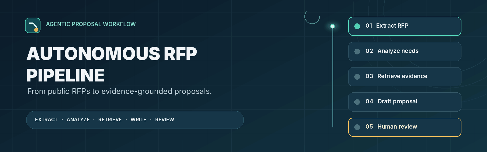

<br>

[](https://www.python.org/)
[](https://fastapi.tiangolo.com/)
[](https://www.langchain.com/langgraph)
[](https://www.llamaindex.ai/)
[](https://openrouter.ai/)
[](https://playwright.dev/)
[](https://docs.celeryq.dev/)
[](https://nextjs.org/)
[](https://www.typescriptlang.org/)
[](https://www.docker.com/)

**Turn an RFP or tender URL into a focused, evidence-grounded proposal — reviewed by an independent AI critic and kept under human control.**

[Live Demo](https://rfpaiagent.vercel.app/) &nbsp;·&nbsp; [Windows Quick Start](#windows-quick-start) &nbsp;·&nbsp; [Architecture](#system-architecture) &nbsp;·&nbsp; [API](#api-reference)

<sub>GitHub-compatible visuals: looping GIFs for motion and crisp SVG illustrations for diagrams.</sub>

</div>

---

## What Is Autonomous RFP Pipeline?

**Autonomous RFP Pipeline** is an AI-assisted proposal workspace for software RFPs, tenders, and relevant project/job postings. It reads a public web page, extracts the client's requirements, searches an uploaded portfolio knowledge base, drafts a tailored proposal, and sends the result through an independent critic and a human review checkpoint.

It is designed to reduce repetitive proposal work while keeping claims grounded in available evidence. It does **not** automatically send or approve proposals.

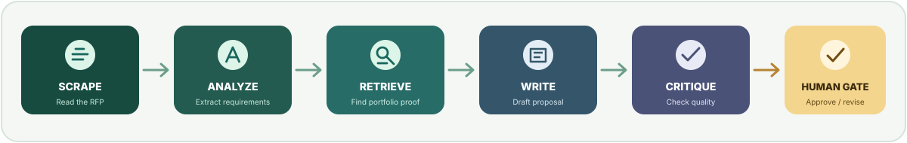

| Input | Output |
|---|---|
| Public HTTP/HTTPS RFP, tender, or project URL | A concise proposal draft (normally 100–180 words) for human review |
| Portfolio knowledge: PDF, TXT, CSV, or Markdown | Relevant portfolio context retrieved from ChromaDB |

> **Note:** The primary proposal workflow accepts a web URL, not an uploaded RFP PDF. File uploads are for the portfolio knowledge base.

## Key Capabilities

- **Multi-stage web extraction:** SeleniumBase/Playwright browser extraction with Playwright and Nodriver fallback paths.
- **Requirement analysis:** Identifies goals, technical requirements, deliverables, constraints, and unanswered questions.
- **Portfolio RAG:** Uses hybrid vector and keyword retrieval to find relevant project evidence.
- **Proposal generation:** Creates concise, client-specific drafts with rules against fabricated experience or commitments.
- **Independent AI critic:** Checks technical alignment, omissions, contradictions, and unsupported claims.
- **Human approval gate:** Pauses the workflow so a person can edit, revise, or approve the draft.
- **Async execution:** FastAPI queues longer work for a separate Celery worker.
- **Workspace UI:** Task monitoring, editable proposal, Markdown preview, copy/download, recent runs, and Knowledge Admin.

<details>
<summary><b>Quick glossary</b></summary>

| Term | Meaning here |
|---|---|
| RFP | A request describing a client's project and asking for proposals |
| Agent | An AI stage with a defined responsibility, such as analysis or writing |
| LangGraph checkpoint | A saved workflow state that can be resumed after human review |
| RAG | Retrieval-Augmented Generation: find relevant documents first, then use them as context |
| Embedding | A numerical representation of text meaning, used for similarity search |
| BM25 | Keyword-based retrieval that complements vector search |

</details>

---

## System Architecture

The web app handles user interaction. FastAPI validates requests and queues long-running work. A separate Celery worker executes the LangGraph workflow. Redis handles task messages/results; SQLite and ChromaDB store different kinds of persistent data.

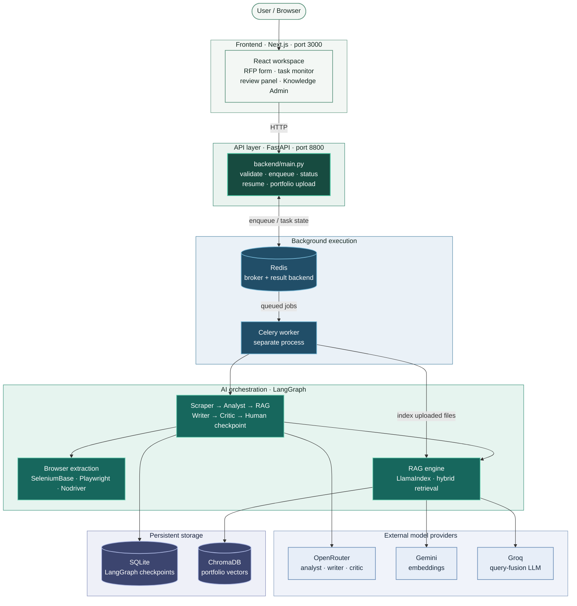

| Layer | Main responsibility |
|---|---|
| Next.js frontend | Collects the URL, displays task state, and presents the review workspace |
| FastAPI | Validates requests and exposes task, review, and upload endpoints |
| Celery + Redis | Runs long jobs outside the HTTP request |
| LangGraph | Coordinates the AI stages and pauses for human review |
| OpenRouter, Gemini, Groq | Provide agent LLMs, embeddings, and retrieval query generation |
| SQLite + ChromaDB | Persist workflow checkpoints and portfolio vectors respectively |

> **Run all services:** FastAPI does not start Redis or the Celery worker. Start each separately as shown in [Windows Quick Start](#windows-quick-start).

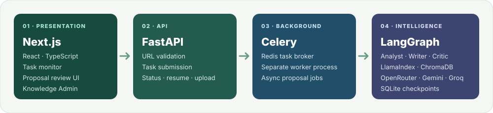

## Complete Proposal Workflow

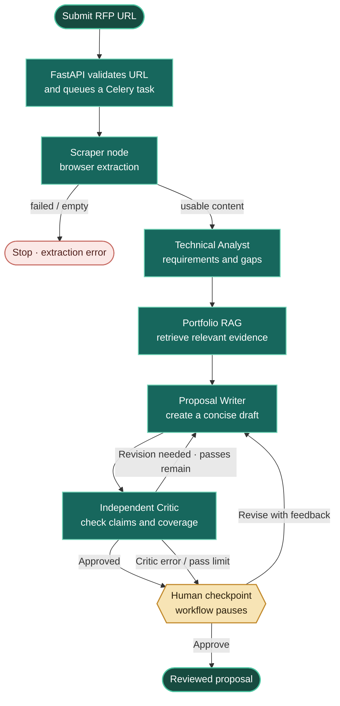

1. **Submit:** FastAPI validates an HTTP/HTTPS URL and queues a task.
2. **Extract:** Browser engines retrieve page content. Empty or unusable content stops the run.
3. **Analyze:** The analyst structures the client's goals, requirements, deliverables, and gaps.
4. **Retrieve:** RAG searches the portfolio knowledge base. The workflow can continue if no relevant portfolio context is found.
5. **Write:** The writer creates a focused proposal using the RFP, analysis, and available portfolio evidence.
6. **Critique:** An independent agent checks the draft. `REVISION_NEEDED` sends it back to the writer while passes remain.
7. **Review:** The workflow pauses for a human decision. Critic approval never bypasses the human gate.

The workflow supports up to **three writer passes** (`MAX_WRITER_PASSES`). An unparseable critic response is marked `CRITIC_ERROR` and sent for manual review.

## AI Agents

All stages are orchestrated in `backend/main.py` using LangGraph.

| Stage | Function | Responsibility |
|---|---|---|
| Scraper | `scraper_node` | Calls the scraping engine and validates extracted content |
| Technical Analyst | `analyst_node` | Identifies business goals, technical requirements, deliverables, constraints, and questions |
| Portfolio RAG | `rag_node` | Retrieves relevant portfolio evidence; records a warning if none is usable |
| Proposal Writer | `writer_node` | Creates a tailored, client-facing proposal |
| Independent Critic | `critic_node` | Checks alignment, correctness, omissions, contradictions, and unsupported claims |
| Human Checkpoint | `human_checkpoint_node` | Uses LangGraph `interrupt()` to pause for approval or revision |

**Proposal safeguards:** The writer is instructed not to invent clients, past projects, credentials, certifications, metrics, budgets, prices, deadlines, availability, guarantees, or business results. The usual target is 100–180 words (preferred 120–160), beginning with `Hi,` and ending with the configured sign-off `Best regards, Faizan`.

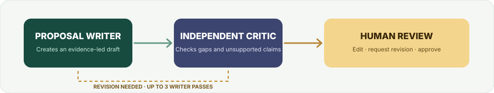

---

## Web Scraping Architecture

Scraping is a **best-effort, multi-stage browser extraction process**. Fallbacks improve resilience, but no browser automation method can guarantee access to every website.

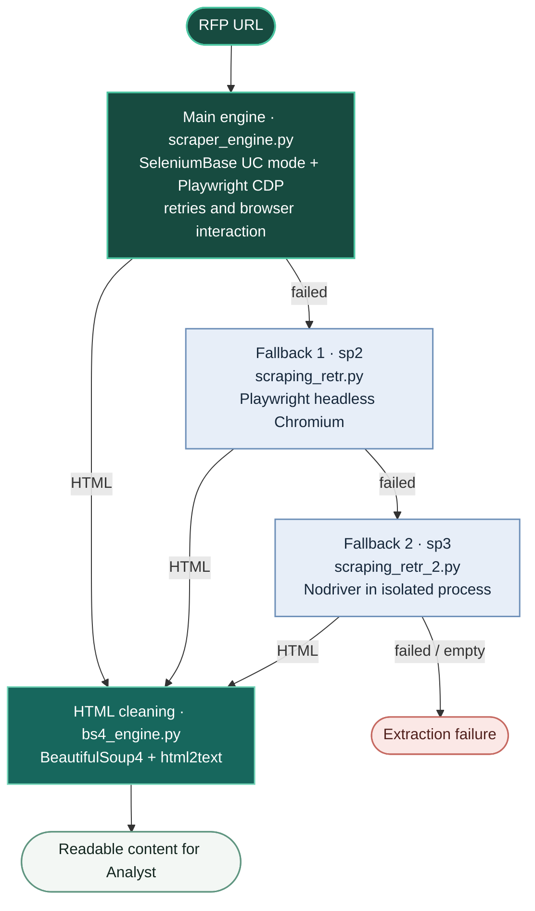

| Stage | File | Tools / role |
|---|---|---|
| Main engine | `backend/scraper_engine.py` | SeleniumBase undetected Chrome mode, Playwright, CDP, retries |
| Fallback 1 (`sp2`) | `backend/scraping_retr.py` | Separate headless Playwright Chromium browser |
| Fallback 2 (`sp3`) | `backend/scraping_retr_2.py` | Nodriver in an isolated process with timeout/cleanup handling |
| HTML cleaning (`chtm`) | `backend/bs4_engine.py` | Removes common page noise and converts HTML into readable text |

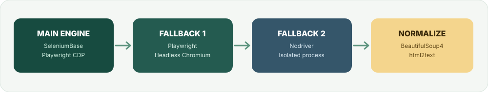

**Possible extraction blockers:** login walls, CAPTCHA, anti-bot restrictions, incomplete dynamic content, network failures, and sites requiring complex interaction. The main RFP input is a URL; PDF uploads are not the RFP scraping input.

## Portfolio RAG Architecture

The RAG implementation lives in `backend/rag_engine.py`. It retrieves relevant portfolio evidence so a proposal can refer to real, documented experience instead of invented claims.

### 1. Add portfolio knowledge

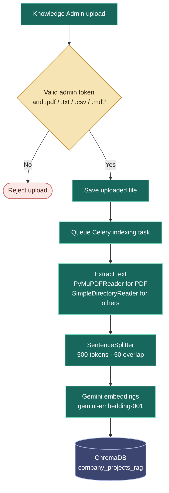

### 2. Retrieve evidence for a proposal

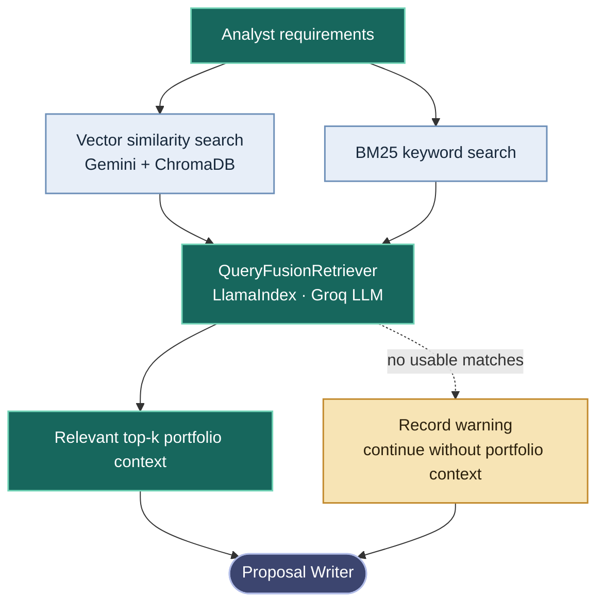

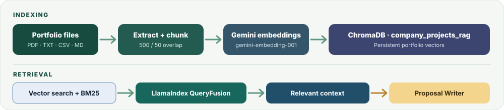

| Setting | Current implementation |
|---|---|
| Embedding model | `gemini-embedding-001` via `GeminiTenacityEmbedding` |
| Retrieval LLM | Groq `openai/gpt-oss-20b` in the query-fusion setup |
| Vector store | ChromaDB collection `company_projects_rag` |
| Default vector folder | `./embeddings_Store` |
| Retrieval strategy | Vector similarity + BM25 combined by `QueryFusionRetriever` |
| Chunking | `SentenceSplitter`, size 500, overlap 50 |
| Supported uploads | PDF, TXT, CSV, Markdown |

> **Portfolio setup matters:** `past_projects.md.example` is a template only. The current code does not automatically index `past_projects.md`. Fill the template with real, authorized information, save it as a supported file, then upload it through Knowledge Admin or the protected API. An upload response means indexing was queued, not that it has finished.

## Technology Stack

| Area | Technologies | Purpose |
|---|---|---|
| Backend | Python 3.12, FastAPI, Uvicorn | API and application server |
| Agent orchestration | LangGraph, LangChain | Stateful multi-stage workflow and model integration |
| Retrieval | LlamaIndex, ChromaDB, BM25 | Portfolio indexing and hybrid search |
| Language models | OpenRouter, Gemini, Groq | Agent generation, embeddings, and query fusion |
| Background processing | Celery, Redis, asyncio | Execute time-consuming tasks outside the API request |
| Persistence | SQLite, ChromaDB | Workflow checkpoints and portfolio vectors |
| Browser automation | SeleniumBase, Playwright, Nodriver | RFP page extraction and fallbacks |
| Content processing | BeautifulSoup4, html2text, PyMuPDF | Clean HTML and read portfolio PDFs |
| Frontend | Next.js 15, React 19, TypeScript, Tailwind CSS 4 | Web workspace and interface |
| Motion and UI | Framer Motion, GSAP, Lenis, Lucide React, React Markdown | UI motion, icons, and Markdown rendering |
| Optional packaging | Docker Compose | Optional container-based development setup |

### Model provider responsibilities

| Provider | Used for |
|---|---|
| **OpenRouter** | Technical Analyst, Proposal Writer, and Independent Critic through LangChain `ChatOpenAI` |
| **Gemini** | `gemini-embedding-001` embeddings for portfolio indexing and retrieval |
| **Groq** | `openai/gpt-oss-20b` in the LlamaIndex query-fusion configuration |

The default model for the three LangGraph agents is `nvidia/nemotron-3.5-super-vl:free`. Override models with `ANALYZER_LLM_MODEL`, `WRITER_LLM_MODEL`, and `CRITIC_LLM_MODEL`. `OPENROUTER_API_KEYS` supports comma-separated keys.

---

## Repository Structure

```text
Autonomous-RFP-Pipeline/
│
├── backend/
│   ├── main.py                 # FastAPI, Celery tasks, LangGraph workflow and API routes
│   ├── rag_engine.py           # Portfolio indexing and hybrid retrieval
│   ├── scraper_engine.py       # Main browser extraction engine
│   ├── scraping_retr.py        # Playwright fallback (sp2)
│   ├── scraping_retr_2.py      # Nodriver fallback (sp3)
│   ├── bs4_engine.py           # HTML cleanup and text conversion
│   ├── requirements.txt        # Python dependencies
│   └── .env.example            # Backend environment sample
│
├── frontend/
│   ├── app/                    # Main page, layout, styles and app icon
│   ├── components/             # Reusable UI and motion components
│   ├── lib/                    # API helpers, local storage and utilities
│   ├── package.json            # Frontend scripts and dependencies
│   └── .env.local.example      # Frontend API URL sample
│
├── docs/
│   └── assets/                 # README SVG illustrations and animated GIFs
│
├── downloaded_files/           # Runtime/download support folder
├── .env.example                # Root environment sample
├── docker-compose.yml           # Optional Docker services
├── past_projects.md.example     # Portfolio content template (not auto-indexed)
└── project_run_commands         # Original Windows command notes
```

---

## Windows Quick Start

**Recommended setup:** run the backend and frontend directly on Windows using PowerShell. Docker is optional and is not required for this method.

### 1. Requirements

| Requirement | Recommended version / note |
|---|---|
| Windows | Windows 10 or 11 |
| Python | 3.12 |
| Node.js | 22 LTS |
| npm | Installed with Node.js |
| Redis | A Redis-compatible server reachable at `REDIS_URL` |
| Browser | Google Chrome plus Playwright Chromium |
| API credentials | OpenRouter; Gemini and Groq for portfolio RAG |

Check Python and Node.js before proceeding:

```powershell
py -3.12 --version
node --version
npm --version
```

Redis is a separate prerequisite. Start your Redis-compatible service before starting FastAPI or the Celery worker. The default connection is `redis://localhost:6379/0`.

### 2. Get the project

**Option A — Clone with Git (recommended)**

```powershell
git clone https://github.com/mrfaizan-dev/Autonomous-RFP-Pipeline.git
cd Autonomous-RFP-Pipeline
```

**Option B — Download the ZIP**

1. Open the [GitHub repository](https://github.com/mrfaizan-dev/Autonomous-RFP-Pipeline).
2. Select **Code → Download ZIP**.
3. Extract the ZIP file.
4. Open PowerShell in the extracted project folder.

GitHub normally names the extracted folder `Autonomous-RFP-Pipeline-main`. You can rename it to `Autonomous-RFP-Pipeline` to use the same commands below. If you keep the original name, replace `Autonomous-RFP-Pipeline` in each `cd` command with `Autonomous-RFP-Pipeline-main`.

**Terminal location:** Run the commands from the folder that contains the project directory (for example, your workspace or Downloads folder). Repeat the same starting location in each new PowerShell terminal before running its `cd` commands.

### 3. Configure backend environment variables

From the project root, create the root `.env` file:

```powershell
Copy-Item .env.example .env
notepad .env
```

Use the variable names read by the current backend code:

```env
OPENROUTER_API_KEYS=your_openrouter_api_key
GEMINI_API_KEYS=your_gemini_api_key
GROQ_API_KEYS=your_groq_api_key
ADMIN_SECRET_KEY=replace_with_a_long_random_secret
REDIS_URL=redis://localhost:6379/0

ANALYZER_LLM_MODEL=nvidia/nemotron-3.5-super-vl:free
WRITER_LLM_MODEL=nvidia/nemotron-3.5-super-vl:free
CRITIC_LLM_MODEL=nvidia/nemotron-3.5-super-vl:free
LOG_LEVEL=INFO
```

- **OpenRouter** is required for the Analyst, Writer, and Critic agents.
- **Gemini** provides portfolio embeddings.
- **Groq** is used by the RAG query-fusion setup.
- **ADMIN_SECRET_KEY** protects portfolio uploads. Replace the example with a strong random secret.
- **REDIS_URL** points to your running Redis service.

**Environment sample warning:** the current root `.env.example` uses `GEMINI_API_KEY` and `GROQ_API_KEY`, but `rag_engine.py` reads the plural names `GEMINI_API_KEYS` and `GROQ_API_KEYS`. Use the plural names shown above. The sample also does not define `REDIS_URL`; add it as shown if you use the default local Redis address.

The backend loads the repository-root `.env` and can also load `backend/.env`. Keep private keys in backend-side environment files only. Do not put API keys in frontend variables or commit real secrets.

### 4. Start the backend — Terminal 1

Open a **new PowerShell terminal** and run:

```powershell
cd Autonomous-RFP-Pipeline
cd backend

if (-not (Test-Path ".venv")) {
    py -3.12 -m venv .venv
}

.\.venv\Scripts\Activate.ps1
python -m pip install --upgrade pip
pip install -r requirements.txt
python -m playwright install chromium

python main.py
```

If PowerShell blocks `Activate.ps1`, run `Set-ExecutionPolicy -Scope Process -ExecutionPolicy Bypass` in that terminal, then activate the environment again.

FastAPI will be available at:

- API: `http://127.0.0.1:8800`
- Swagger UI: `http://127.0.0.1:8800/docs`

Keep this terminal open.

### 5. Start the Celery worker — Terminal 2

Open a **second PowerShell terminal**. The worker must use the same backend virtual environment:

```powershell
cd Autonomous-RFP-Pipeline
cd backend
.\.venv\Scripts\Activate.ps1

celery -A main.celery_app worker --loglevel=INFO --pool=solo
```

Keep this terminal open too. Without the worker, background tasks can remain queued.

### 6. Start the frontend — Terminal 3

Open a **third PowerShell terminal**:

```powershell
cd Autonomous-RFP-Pipeline
cd frontend

if (-not (Test-Path ".env.local")) {
    Copy-Item .env.local.example .env.local
}

npm install
npm run dev
```

Open the application at **http://localhost:3000**.

The frontend API setting is in `frontend/.env.local`:

```env
NEXT_PUBLIC_API_BASE_URL=http://127.0.0.1:8800
```

If you change this value, restart the Next.js development server. `NEXT_PUBLIC_*` values are visible in the browser; never store private provider keys there.

### Startup checklist

| Service | Start it | Default address |
|---|---|---|
| Redis | Start separately before the app | `redis://localhost:6379/0` |
| FastAPI | Terminal 1 | `http://127.0.0.1:8800` |
| Celery worker | Terminal 2 | Background process |
| Next.js | Terminal 3 | `http://localhost:3000` |

**All four services must be available:** Redis, FastAPI, Celery worker, and the frontend. Keep the three project terminals running while using the application.

---

## How to Use the Application

1. Start Redis, FastAPI, the Celery worker, and the frontend.
2. Open `http://localhost:3000`.
3. Paste a public RFP, tender, or relevant project URL.
4. Submit the request and monitor the Celery task state.
5. When the LangGraph workflow pauses, review the generated proposal.
6. Edit the draft, copy it, or download it as Markdown.
7. Approve it or submit revision feedback, keeping the integration note below in mind.

### Knowledge Admin — add your portfolio

1. Open **Knowledge Admin** (Windows shortcut: `Ctrl + Shift + A`).
2. Enter the value configured as `ADMIN_SECRET_KEY`.
3. Upload an authorized `.pdf`, `.txt`, `.csv`, or `.md` portfolio document.
4. The backend queues a Celery indexing task. Check the worker terminal for processing output.

A queued response does not mean indexing has completed. Add real projects, technologies, and outcomes that you are permitted to share. Without usable portfolio context, proposal generation can continue, but the writer has no verified project evidence to reference.

### Frontend behavior

- The task monitor polls `GET /api/task-status/{task_id}` approximately every 1.8 seconds while the initial task is queued or running.
- It displays Celery task state, not live per-agent LangGraph telemetry.
- Up to 10 recent runs are stored in browser `localStorage`; this is not a central backend history database.
- Clearing browser history does not cancel Celery tasks or delete SQLite checkpoints.
- The admin token is currently stored in browser `localStorage`; see [Security Notes](#security-and-production-notes).

## Human Review and Current Integration Note

LangGraph pauses at `human_checkpoint_node` using `interrupt()`. A reviewer can inspect the draft, edit it, approve it, or request a revision with feedback. The state is persisted using `AsyncSqliteSaver` in SQLite (default: `backend/langgraph_checkpoints.sqlite`). This checkpoint database is separate from Redis.

| Action | Expected effect |
|---|---|
| `APPROVE` | Finalizes the proposal; edited proposal text can be submitted |
| `REVISE` | Sends feedback back to the writer; feedback is required |

> **Frontend/backend integration to validate:** `POST /api/resume-proposal/{thread_id}` queues the resume operation and immediately returns a processing response with a new Celery task ID. The current frontend resume handler appears to expect a completed result or another review result immediately, and does not visibly poll that new resume-task ID. Validate the full approve/revise cycle end to end before relying on it. The API can be tested directly using the task-status endpoint.

---

## API Reference

Base URL: `http://127.0.0.1:8800` · Interactive docs: [`/docs`](http://127.0.0.1:8800/docs)

| Method | Endpoint | Purpose |
|---|---|---|
| `POST` | `/api/generate_proposal` | Validate and queue an RFP URL |
| `GET` | `/api/task-status/{task_id}` | Read Celery task state and result information |
| `POST` | `/api/resume-proposal/{thread_id}` | Queue approval or revision of a paused workflow |
| `POST` | `/api/admin/upload-rag-file` | Upload portfolio knowledge (admin token required) |
| `GET` | `/docs` | FastAPI Swagger UI |
| `GET` | `/openapi.json` | OpenAPI specification |

### Submit an RFP

`POST /api/generate_proposal`

```json
{
  "url": "https://example.com/rfp"
}
```

The legacy `rfp_url` field is also accepted. The initial response includes `message`, `task_id`, `thread_id`, and `status` (normally `Processing`).

### Check task status

`GET /api/task-status/{task_id}`

Common Celery states:

| State | Meaning |
|---|---|
| `PENDING` | Queued, or the supplied task ID is unknown |
| `STARTED` | A worker is processing the task |
| `RETRY` | The task is being retried |
| `SUCCESS` | The task finished |
| `FAILURE` | The task failed |

The response may also indicate that the LangGraph run has paused for human review.

### Resume a paused proposal

`POST /api/resume-proposal/{thread_id}`

Approve:

```json
{
  "action": "APPROVE",
  "feedback": null,
  "edited_proposal": "Hi, ...\n\nBest regards,\nFaizan"
}
```

Request a revision:

```json
{
  "action": "REVISE",
  "feedback": "Please address the missing API integration requirement.",
  "edited_proposal": null
}
```

The endpoint queues a background resume task and returns a new task ID. Poll that ID through `/api/task-status/{task_id}`.

### Upload portfolio knowledge

`POST /api/admin/upload-rag-file`

- Content type: multipart form upload.
- Required header: `X-Admin-Token` matching `ADMIN_SECRET_KEY`.
- Allowed extensions: `.pdf`, `.txt`, `.csv`, `.md`.
- Response: upload/indexing task queued, not proof of completed indexing.

Use Swagger at `/docs` to inspect the exact upload form fields.

---

## Data Storage

| Data | Location | Purpose |
|---|---|---|
| Celery queue/results | Redis (`REDIS_URL`) | Background task messaging and result backend |
| LangGraph workflow state | SQLite, default `backend/langgraph_checkpoints.sqlite` | Resume paused workflows |
| Portfolio vectors | ChromaDB, collection `company_projects_rag`, default `./embeddings_Store` | Similarity and hybrid retrieval |
| Recent runs and admin token | Browser `localStorage` | Local workspace convenience; not shared between users |
| Uploaded source documents | Backend upload storage | Source files for background indexing |

The application uses SQLite and ChromaDB for its described persistence; it does not use PostgreSQL or MySQL in this implementation.

## Security and Production Notes

This repository is a development-oriented project, not a production-hardened service. Review these points before exposing it publicly.

| Area | Current implementation | Before production |
|---|---|---|
| API secrets | Read from backend environment variables | Keep keys out of source control and frontend code |
| Admin token | Frontend has a hard-coded default and stores the entered token in `localStorage` | Remove the client-side default and implement a safer authentication flow |
| CORS | Current middleware allows wildcard origins | Restrict access to trusted frontend origins |
| Submitted URLs | HTTP/HTTPS validation | Add SSRF protection, URL restrictions, authentication, and rate limits |
| Uploads | Admin token and extension checks | Add upload-size limits, stronger file validation, and storage controls |
| Portfolio/RFP data | May contain confidential business information | Upload only authorized data and avoid committing secrets or private client material |

The current `FRONTEND_ORIGINS` setting is parsed, but the middleware's wildcard policy means setting that variable does not currently restrict CORS. `LANGFUSE_*` values appear in sample configuration without an active Langfuse integration; `TAVILY_API_KEY` is also present in a sample but is not used by the active application code.

## Known Limitations

- Web scraping is best-effort; authentication, CAPTCHA, anti-bot controls, and dynamic pages can block extraction.
- RAG quality depends on a populated ChromaDB collection. `past_projects.md.example` is not automatically imported.
- Frontend history is browser-local and limited to the latest 10 runs.
- Task monitoring shows Celery states, not every LangGraph node transition.
- The resume endpoint/frontend response handling needs end-to-end validation, as described above.
- The current frontend admin-token default and permissive CORS need attention before public deployment.
- External model availability, API keys, quotas, and model access affect execution.
- The repository contains pytest-related dependencies but no verified automated test suite or benchmark results are claimed here.

## Troubleshooting

| Symptom | What to check |
|---|---|
| Redis connection error | Redis is running and `REDIS_URL` points to the correct host/port |
| Task stays `PENDING` | Celery worker is running in Terminal 2 and connected to the same Redis instance; also verify the task ID |
| OpenRouter key missing | `OPENROUTER_API_KEYS` exists in the backend environment; restart API and worker after changes |
| RAG indexing/retrieval fails | Check plural `GEMINI_API_KEYS` and `GROQ_API_KEYS`, ChromaDB storage, supported extensions, and worker logs |
| Browser extraction fails | Install Playwright Chromium, ensure Chrome/network access, and check whether the site requires login or blocks automation |
| Frontend cannot reach API | Check FastAPI on port 8800 and `NEXT_PUBLIC_API_BASE_URL` in `frontend/.env.local`; restart Next.js after editing |
| PowerShell blocks activation | Run `Set-ExecutionPolicy -Scope Process -ExecutionPolicy Bypass` in that terminal, then activate the venv again |
| Python command is not found | Install Python 3.12 and verify `py -3.12 --version` |

---

## Optional: Docker Compose

Docker is optional. The native Windows setup above is the primary quick-start path.

<details>
<summary><b>Open optional Docker instructions</b></summary>

The supplied `docker-compose.yml` defines Redis, backend, Celery worker, and frontend services. It expects a root `.env` file with the correct backend variable names.

```powershell
Copy-Item .env.example .env
```

The Compose file also bind-mounts `past_projects.md`; create it if it is not present:

```powershell
Copy-Item past_projects.md.example past_projects.md
```

Build and start:

```bash
docker compose up --build
```

| Service | Address |
|---|---|
| Frontend | `http://localhost:3001` |
| Backend API | `http://localhost:8800` |
| Redis | Internal Compose network |

Compose creates persistent volumes for Redis, SQLite checkpoints, ChromaDB, and uploads. Two current configuration details matter:

- Mounting `past_projects.md` does not import it into ChromaDB; the RAG implementation does not auto-index that file.
- The upload volume is mounted in the backend container but not the worker container. This can affect worker-side indexing of uploaded files in Docker mode.

> **Data warning:** `docker compose down -v` removes volumes and can delete Redis data, checkpoints, vectors, and uploaded files.

</details>

---

## Project Notes

- The repository is named **Autonomous RFP Pipeline**; the active web interface is labelled **AegisIQ**. Some older metadata still uses **BidForge**.
- The active backend entry point is `backend/main.py`. The older `frontend/README.md` contains outdated references and should not be used as the root setup guide.
- `FILES.txt` refers to a `DOCKER_SETUP_GUIDE.md` that is not present in the repository.
- No license file is currently included. Add a license before presenting the project as open-source under a specific license.

---

<div align="center">

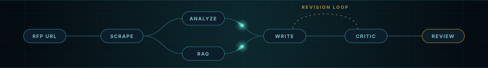


**Designed & Developed by [Mr Faizan](https://github.com/mrfaizan-dev)**  
*Software Developer · AI Engineering · Full-Stack Systems*

[Back to top ↑](#what-is-autonomous-rfp-pipeline)

</div>
