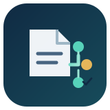
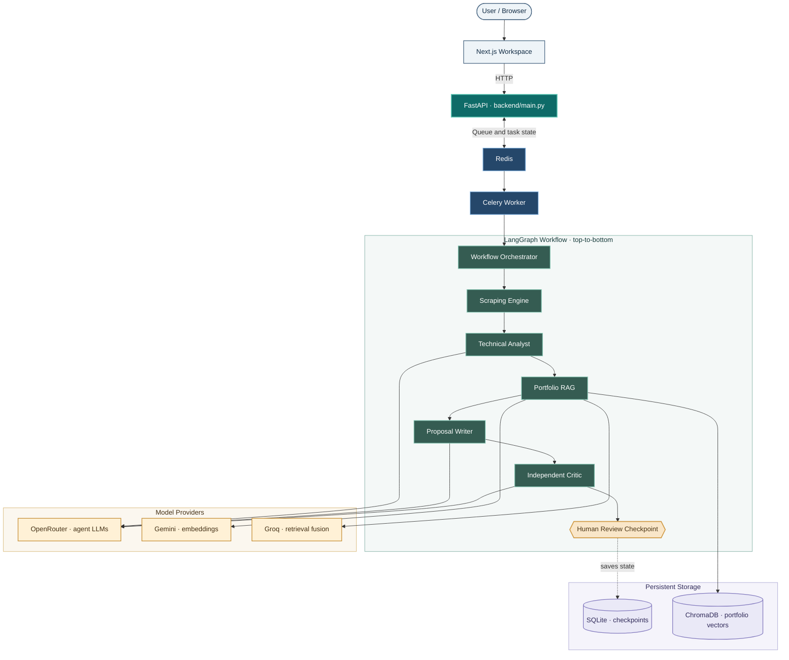
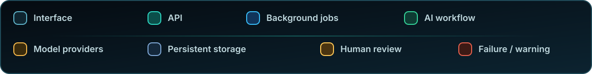
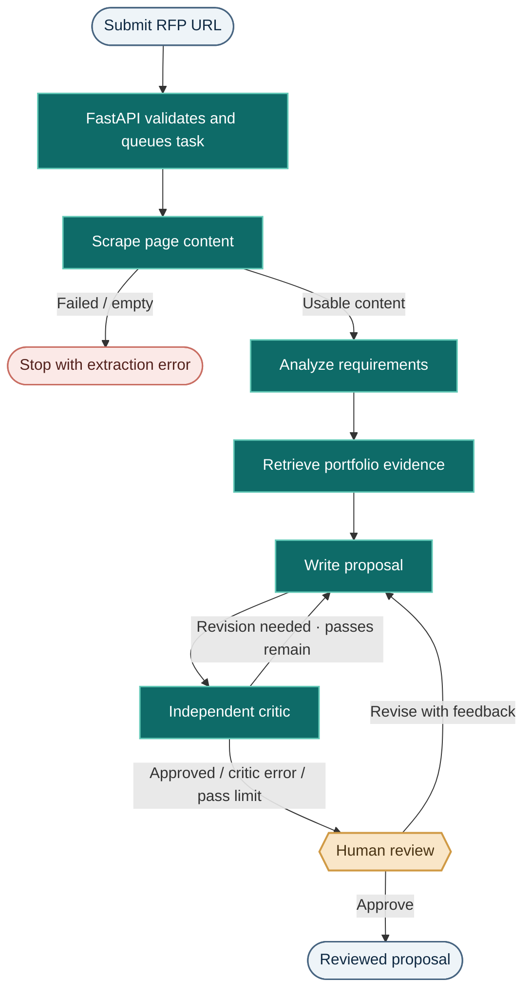
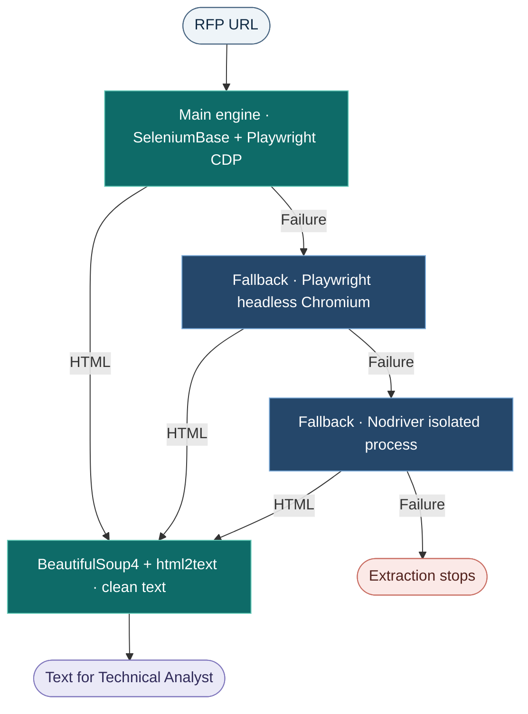
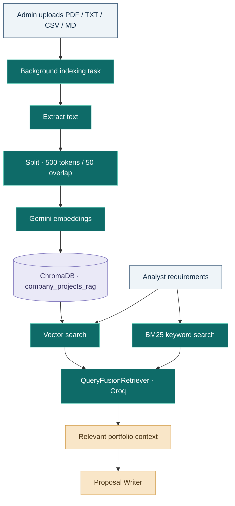

<div align="center">




[](https://www.python.org/)
[](https://fastapi.tiangolo.com/)
[](https://www.langchain.com/langgraph)
[](https://www.llamaindex.ai/)
[](https://openrouter.ai/)
[](https://playwright.dev/)
[](https://nextjs.org/)
[](https://www.docker.com/)

**Turn an RFP URL into a tailored, evidence-grounded proposal — checked by an independent AI critic and submitted for human review.**

<sub><a href="./hero-still.svg">View the static SVG artwork</a></sub>

[Live Demo](https://rfpaiagent.vercel.app/) · [Windows Quick Start](#windows-quick-start) · [Architecture](#system-architecture) · [API](#review-and-api)

</div>

# Autonomous RFP Pipeline

---

## What It Does

**Autonomous RFP Pipeline** helps turn software project opportunities into focused proposal drafts. Submit a public RFP, tender, or project-posting URL; the system extracts the page, analyzes its requirements, searches your portfolio knowledge base, writes a proposal, and pauses for a human decision.

| Input | Result |
|---|---|
| Public HTTP/HTTPS RFP or project URL | A tailored proposal draft, normally 100–180 words |
| Portfolio files (`PDF`, `TXT`, `CSV`, `MD`) | Relevant project context retrieved from ChromaDB |

**Core capabilities:** browser-based extraction with fallbacks · requirement analysis · hybrid portfolio RAG · proposal writing · independent AI critique · human approval/revision · local run history and proposal export.

> The main proposal flow accepts a **web URL**, not an uploaded RFP PDF. File uploads are for portfolio knowledge only. The system drafts proposals; it does not automatically send them to clients.

## System Architecture

The frontend sends requests to FastAPI. Redis and Celery handle background work, while a LangGraph workflow coordinates scraping, analysis, retrieval, writing, critique, and human review. SQLite stores workflow checkpoints; ChromaDB stores portfolio vectors.





## End-to-End Workflow



| Stage | Responsibility |
|---|---|
| **Scraper** | Extracts and cleans the public page content; stops if the result is unusable. |
| **Technical Analyst** | Identifies goals, requirements, deliverables, constraints, and missing information. |
| **Portfolio RAG** | Retrieves relevant past-project evidence; the workflow can continue without a match. |
| **Proposal Writer** | Drafts a concise, client-specific proposal without inventing experience or commitments. |
| **Independent Critic** | Checks technical alignment, omissions, contradictions, and unsupported claims. |
| **Human Checkpoint** | Pauses for a person to edit, revise, or approve the draft. |

The critic can request revisions. The graph allows up to **three writer passes**. Even when the critic returns `APPROVED`, a human review is still required. An unparseable critic response is treated as `CRITIC_ERROR` and sent for manual review.

## Extraction & Portfolio Knowledge

### Web scraping

The scraper is best-effort: fallbacks improve resilience but cannot guarantee extraction from every site.



| Component | File | Role |
|---|---|---|
| Main engine | `backend/scraper_engine.py` | SeleniumBase undetected Chrome mode, Playwright/CDP, retries |
| Fallbacks | `backend/scraping_retr.py`, `backend/scraping_retr_2.py` | Playwright and Nodriver extraction |
| HTML cleaning | `backend/bs4_engine.py` | BeautifulSoup4 removes page noise; html2text converts content |

### Portfolio RAG

Upload portfolio files through **Knowledge Admin**. A Celery task extracts text, splits it into chunks, creates Gemini embeddings, and stores them in ChromaDB. At retrieval time, vector search and BM25 keyword search are combined by LlamaIndex `QueryFusionRetriever` (Groq is used in the fusion setup).



- **Embedding model:** `gemini-embedding-001`; vector collection: `company_projects_rag`.
- **Chunking:** `SentenceSplitter`, size 500, overlap 50; PDFs use PyMuPDFReader.
- **Storage:** ChromaDB persists under `./embeddings_Store`; LangGraph checkpoints use SQLite (`backend/langgraph_checkpoints.sqlite` by default).
- **Important:** `past_projects.md.example` is only a template. `past_projects.md` is **not imported automatically**. Fill it with real projects, then upload the resulting `.md` file through Knowledge Admin.

## Technology Stack

| Area | Technologies used in this repository |
|---|---|
| Backend and API | Python 3.12, FastAPI, Uvicorn, Pydantic v2 |
| Agent orchestration | LangGraph, LangChain |
| Retrieval and storage | LlamaIndex, Gemini embeddings, ChromaDB, BM25, SQLite |
| Model providers | OpenRouter (agents), Gemini (embeddings), Groq (retrieval fusion) |
| Background processing | Celery and Redis |
| Browser extraction | SeleniumBase, Playwright, Nodriver, BeautifulSoup4, html2text |
| Frontend | Next.js 15, React 19, Tailwind CSS 4, Framer Motion, GSAP, Lenis |
| Optional deployment | Docker Compose |

> The project uses OpenRouter for the Analyst, Writer, and Critic; Gemini for embeddings; and Groq in the RAG query-fusion setup. These providers have different responsibilities.

## Windows Quick Start

**The native Windows setup is the recommended path. Docker is optional.** You need Redis running separately and three PowerShell terminals for the application services.

### 1. Get the project

**Option A — Git clone**

```powershell
git clone https://github.com/mrfaizan-dev/Autonomous-RFP-Pipeline.git
cd Autonomous-RFP-Pipeline
```

**Option B — Download ZIP**

1. Open the [GitHub repository](https://github.com/mrfaizan-dev/Autonomous-RFP-Pipeline).
2. Select **Code → Download ZIP**, then extract it.
3. Open PowerShell in the extracted folder:

```powershell
cd .\Autonomous-RFP-Pipeline-main
```

> Use the folder name created by extraction if Windows adds a suffix such as `(1)`.

### 2. Install prerequisites

- Windows 10/11 and **Python 3.12** (`py -3.12 --version`).
- **Node.js 22 LTS** and npm (`node -v`, `npm -v`).
- A running Redis-compatible server reachable at `redis://localhost:6379/0` (or your own `REDIS_URL`). Redis is required by Celery; this repository does not install Redis for native Windows.
- API keys: OpenRouter for proposal agents; Gemini and Groq for portfolio RAG.
- Internet access and browser dependencies for scraping.

### 3. Configure environment variables

Run these commands from the **repository root**:

```powershell
Copy-Item .env.example .env
notepad .env
```

Add or update these exact variable names in `.env`:

```env
OPENROUTER_API_KEYS=your_openrouter_api_key
GEMINI_API_KEYS=your_gemini_api_key
GROQ_API_KEYS=your_groq_api_key
ADMIN_SECRET_KEY=replace_with_a_long_random_secret
REDIS_URL=redis://localhost:6379/0
```

Optional model overrides: `ANALYZER_LLM_MODEL`, `WRITER_LLM_MODEL`, and `CRITIC_LLM_MODEL`.

> **Configuration note:** The root `.env.example` currently uses singular names for Gemini and Groq, but the backend reads `GEMINI_API_KEYS` and `GROQ_API_KEYS` (plural). Use the plural names above. Never commit `.env` or expose provider keys in frontend variables.

Create the frontend environment file:

```powershell
if (-not (Test-Path .\frontend\.env.local)) { Copy-Item .\frontend\.env.local.example .\frontend\.env.local }
```

Confirm it contains:

```env
NEXT_PUBLIC_API_BASE_URL=http://127.0.0.1:8800
```

### 4. Start the services

Start Redis first. Keep it running, then open **three separate PowerShell terminals** in the repository folder.

<details open>
<summary><b>Terminal 1 — FastAPI backend</b></summary>

```powershell
cd .\backend
if (-not (Test-Path ".venv")) { py -3.12 -m venv .venv }
.\.venv\Scripts\Activate.ps1
python -m pip install --upgrade pip
pip install -r requirements.txt
python -m playwright install chromium
python main.py
```

Backend: `http://127.0.0.1:8800` · Swagger: `http://127.0.0.1:8800/docs`

</details>

<details>
<summary><b>Terminal 2 — Celery worker</b></summary>

```powershell
cd .\backend
.\.venv\Scripts\Activate.ps1
celery -A main.celery_app worker --loglevel=INFO --pool=solo
```

The worker uses the same `.venv` and environment as FastAPI. `--pool=solo` is the intended local Windows setting.

</details>

<details>
<summary><b>Terminal 3 — Next.js frontend</b></summary>

```powershell
cd .\frontend
if (-not (Test-Path ".env.local")) { Copy-Item .env.local.example .env.local }
npm install
npm run dev
```

Frontend: `http://localhost:3000`

</details>

If PowerShell blocks virtual-environment activation, run this **in that terminal only**, then activate again:

```powershell
Set-ExecutionPolicy -Scope Process -ExecutionPolicy Bypass
```

### 5. Open and use the app

1. Make sure Redis, FastAPI, the Celery worker, and Next.js are all running.
2. Open [`http://localhost:3000`](http://localhost:3000).
3. Paste a public RFP or project URL and submit it.
4. Follow the task monitor. When the workflow reaches human review, inspect and edit the draft.
5. Copy or download the proposal as Markdown. Approval/revision is available in the UI; see the [review integration note](#review-and-api).

## Review and API

The workflow pauses with a LangGraph checkpoint. A reviewer can approve, edit, or request a revision with feedback. Checkpoints are stored in SQLite; Redis is used for task queuing/results.

| Method | Endpoint | Purpose |
|---|---|---|
| `POST` | `/api/generate_proposal` | Submit `{ "url": "https://example.com/rfp" }` |
| `GET` | `/api/task-status/{task_id}` | Read Celery task state |
| `POST` | `/api/resume-proposal/{thread_id}` | Queue approval or revision for a paused run |
| `POST` | `/api/admin/upload-rag-file` | Queue portfolio-file indexing; requires `X-Admin-Token` |
| `GET` | `/docs` | Interactive Swagger documentation |

The status endpoint reports Celery states such as `PENDING`, `STARTED`, `RETRY`, `SUCCESS`, or `FAILURE`. `PENDING` can also mean an unknown task ID. Task monitoring polls about every 1.8 seconds; it does not stream each LangGraph node's progress.

> **Review integration note:** The backend resume endpoint responds immediately with a new Celery task ID. The current frontend resume handler does not visibly poll that new task ID, so the complete browser-based approve/revise cycle needs end-to-end validation before relying on it. The backend route itself is available and can be tested through Swagger.

### Add your portfolio knowledge

Open **Knowledge Admin** (`Ctrl + Shift + A` on Windows), enter the value matching `ADMIN_SECRET_KEY`, and upload a `.pdf`, `.txt`, `.csv`, or `.md` file. The upload response means indexing has been queued; check the worker terminal for processing. Use only real, authorized portfolio evidence.

## Project Structure

```text
Autonomous-RFP-Pipeline/
├── backend/
│   ├── main.py                 # FastAPI, Celery tasks, LangGraph workflow
│   ├── rag_engine.py           # Portfolio indexing and hybrid retrieval
│   ├── scraper_engine.py       # Main browser extraction
│   ├── scraping_retr.py        # Playwright fallback
│   ├── scraping_retr_2.py      # Nodriver fallback
│   ├── bs4_engine.py           # HTML cleaning
│   └── requirements.txt
├── frontend/
│   ├── app/                    # Next.js page, layout and styles
│   ├── components/             # UI and motion components
│   ├── lib/                    # API and local-storage helpers
│   └── package.json
├── docs/assets/                # README artwork
├── .env.example
├── docker-compose.yml          # Optional
├── past_projects.md.example
└── project_run_commands
```

## Notes, Limitations & Security

- Some websites block automation, require authentication/CAPTCHA, or return incomplete content. Scraping is not guaranteed.
- Portfolio RAG needs uploaded documents in ChromaDB. The example Markdown file is not auto-indexed.
- Recent run history (up to 10 entries) and the admin token are kept in browser `localStorage`, not a central user database.
- The frontend currently contains a hard-coded default admin-token value; remove it before public deployment. A browser-stored token is not a hidden secret.
- FastAPI CORS currently allows wildcard origins. `FRONTEND_ORIGINS` is parsed but does not currently restrict the middleware. Configure trusted origins before deployment.
- Add SSRF protections and rate limits for public RFP URL submission, plus upload-size and stronger file-validation controls for production.
- Treat RFP text, proposals, and portfolio files as sensitive. Never commit real credentials or confidential client data.
- External providers have their own availability, quota, and model-access limits. No automated test suite or benchmark results are claimed here.

## Troubleshooting

| Issue | Check |
|---|---|
| Redis connection error | Redis is running and `REDIS_URL` is correct. |
| Task remains queued | Terminal 2 worker is running and connected to the same Redis instance. |
| Model/API key error | Check `OPENROUTER_API_KEYS`; for RAG also check plural `GEMINI_API_KEYS` and `GROQ_API_KEYS`. Restart backend and worker after edits. |
| Portfolio search is empty | Upload supported portfolio files and confirm indexing completed in the worker terminal. |
| Scraping fails | Install Playwright Chromium; check network, browser availability, login/CAPTCHA, or site restrictions. |
| Frontend cannot reach API | Check FastAPI on port 8800 and `NEXT_PUBLIC_API_BASE_URL`; restart Next.js after environment changes. |
| Python activation fails | Confirm `py -3.12 --version`; if needed, use the process-only PowerShell execution-policy command above. |

## Optional Docker Compose

Docker is **not required** for the Windows setup. To use the supplied Compose configuration instead, create the root `.env` with the correct variable names and run:

```powershell
Copy-Item .env.example .env
```

Then:

```bash
docker compose up --build
```

| Service | Address |
|---|---|
| Frontend | `http://localhost:3001` |
| Backend | `http://localhost:8800` |
| Redis | Internal Compose network |

Compose persists Redis, SQLite checkpoints, ChromaDB, and uploads in volumes. Current Docker caveat: the upload volume is mounted in the backend but not the worker, which can affect background indexing. Mounting `past_projects.md` also does not auto-index it. **Do not run `docker compose down -v` unless you intend to delete persistent volumes.**

## Developer Toolkit

The following is my broader working toolkit; **not every item is wired into this repository**.

| Focus | Tools and skills |
|---|---|
| **AI and agents** | Python, LangGraph, LangChain, CrewAI, LlamaIndex, LLMs, Prompt Engineering, OpenAI, OpenRouter, Groq, Gemini, Claude, ChatGPT |
| **Evaluation and observability** | Langfuse, DeepEval, Guardrails |
| **RAG and data** | RAG, CRAG (Corrective RAG), ChromaDB, FAISS, Pandas, Pydantic v2 |
| **Scraping and automation** | Playwright, SeleniumBase, Selenium, Nodriver, BeautifulSoup (BS4), Proxy Rotation, asyncio, web scraping across varied sites |
| **Backend and frontend** | FastAPI, Redis, Celery, Docker, Next.js, Tailwind CSS, AI-assisted frontend development |

---

<div align="center">


**[Mr Faizan](https://github.com/mrfaizan-dev)**  
*Software Developer · AI Engineering · Agentic Systems · RAG · Web Automation · Full-Stack Development*

[Back to top ↑](#autonomous-rfp-pipeline)

</div>
